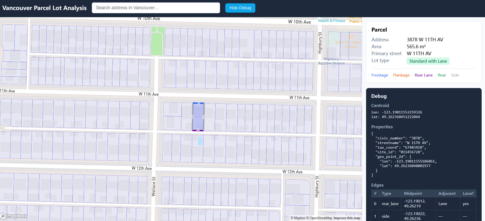

# Vancouver Parcel Lot Analysis Tool

Application for analyzing Vancouver parcel lots: edge types (Frontage, Flankage, Rear Lane, Rear, Side) and lot type (Corner, Double Fronting, Standard with/without Lane).

## UI Showcase



| Requirement |  |
|-------------|--------|
| Framework | React 18+ |
| Language | TypeScript (strict mode) |
| Build Tool | Vite |
| Map | Mapbox GL JS |

## Setup

1. **Node.js**  
   Ensure Node.js 18+ and npm are installed.

2. **Mapbox token**  
   Create a [Mapbox account](https://account.mapbox.com/) and copy your default public token. In the project root, create a `.env` file (you can copy from `.env.example`) and add:
   Create a [Mapbox account](https://account.mapbox.com/) and copy your default public token. In the project root, create a `.env` file and set:

   ```
   VITE_MAPBOX_ACCESS_TOKEN=pk.your_token_here
   ```

   (Note: The `.env` file is excluded from git for security.)

3. **Parcel data**  
   Place `property-parcel-polygons.geojson` in the `public/` folder so it is served at `/property-parcel-polygons.geojson`. A copy step is included in the project (e.g. copy from repo root into `public/` if needed).

4. **Install and run**

   ```bash
   npm install
   npm run dev
   ```

   Open http://localhost:5173.

## Build

```bash
npm run build
npm run preview   # optional: preview production build
```

## Features

1. **Map & Parcel Interaction**  
   Mapbox map centered on downtown Vancouver with parcel polygons rendered. Clicking a parcel highlights it and flies to it.

2. **Address Search with Autocomplete**  
   Search bar with autocomplete dropdown, scoped to Vancouver only. Keyboard navigation (arrow keys, Enter, Esc) and input debounce. Selecting a result triggers the same flow as clicking a parcel (fly to, highlight, analyze, show info card). Search history is shown when the search bar is focused and the input is empty. A “Clear history” button is visible when the history list is displayed.

3. **Parcel Info Card & Classification**  
   When a parcel is selected (via click or search): info card showing full address, area (m²), primary street, and lot type label; edge visualization on the map (Frontage=blue, Flankage=orange, Rear Lane=purple, Rear=green, Side=gray). Debug mode (toggle) shows centroid, properties, per-edge table, and frontage-opposite index; edge numbers on the map are shown only when Debug is on.


## Data and logic

- **Parcel data**: [Vancouver Open Data – Property parcel polygons](https://opendata.vancouver.ca/explore/dataset/property-parcel-polygons) (GeoJSON).
- **Road/lane proximity**: Mapbox Tilequery API (`mapbox.mapbox-streets-v8`) to detect adjacent street/lane and name matching.

### Edge Types

- **Frontage**: Edge adjacent to the parcel's primary street (matched by street name from parcel attributes + spatial proximity to road centerline)
- **Flankage**: Edge adjacent to a secondary street (a different street from the primary). Typically seen on corner lots.
- **Rear Lane**: Edge adjacent to a lane or alley
- **Rear**: Edge on the opposite side of the Frontage that is not adjacent to any road or lane
- **Side**: Any remaining edge connecting the Frontage/Flankage side to the Rear/Rear Lane side

### Lot types (priority order)

- **Corner Lot**: Has both a Frontage edge and a Flankage edge (adjacent to two different streets)
- **Double Fronting**: Has 2 Frontage edges facing different streets (opposite sides both face streets, not lanes)
- **Standard with Lane**: 1 Frontage edge + a Rear Lane edge on the opposite side
- **Standard without Lane**: 1 Frontage edge + a Rear edge on the opposite side (no adjacent lane)
